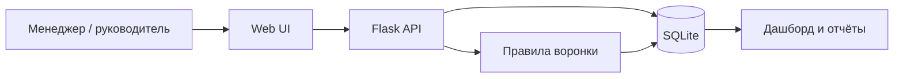

# CRM Process Optimization

### Анализ и совершенствование процесса продаж с помощью CRM

**Проект №1 · Приоритет 1**


[](https://github.com/iwik1329/Pulse-crm/actions/workflows/checks.yml)

**Задача проекта:** показать, где в ручной обработке лидов возникают потери, спроектировать целевой процесс и проверить ключевые правила на работающем прототипе. Репозиторий объединяет бизнес-анализ, диаграммы, требования, сценарную экономику и локальную CRM.

> **Статус данных:** это демонстрационный кейс. AS-IS описан как гипотеза типового отдела продаж; реальные интервью и замеры не проводились. Данные приложения синтетические, а финансовый эффект рассчитан по явным допущениям.

## Результат в одном экране

| Проблема | Решение TO-BE | Проверка в прототипе |
|---|---|---|
| Новая заявка может остаться без действия | Задача первого контакта с SLA 15 минут | Автоматическое создание задачи при добавлении клиента |
| После квалификации нет следующего шага | Задача подготовки КП | Автоматическое создание при смене статуса |
| Предложение забывается без повторного контакта | Контрольная задача на этапах КП и переговоров | Очередь задач и просрочки |
| Закрытые сделки остаются в рабочей очереди | Отмена открытых задач при закрытии | Правило и тест перехода |


## Материалы проекта

| Раздел | Что внутри |
|---|---|
| [Контекст и методика](docs/01-context.md) | Цель, роли, границы кейса, план проверки гипотез |
| [BPMN AS-IS и точки потерь](docs/02-as-is.md) | Ручной процесс, проблемы P1–P4, данные для подтверждения |
| [BPMN TO-BE](docs/03-to-be.md) | Целевой процесс, правила R1–R8 и исключения |
| [UML Use Case и Sequence](docs/04-uml.md) | Акторы, варианты использования, последовательность API |
| [Требования к CRM](docs/05-requirements.md) | FR/NFR, приоритеты, критерии приёмки и статус реализации |
| [KPI и измерение](docs/06-kpi.md) | Формулы, ориентиры пилота, ограничения качества данных |
| [Экономика внедрения](docs/07-economics.md) | Бюджет, три сценария, формулы и чувствительность |
| [Прототип и демо-сценарий](docs/08-prototype.md) | Запуск, действия в интерфейсе, API и тесты |

Файлы [`as-is.bpmn`](docs/diagrams/as-is.bpmn) и [`to-be.bpmn`](docs/diagrams/to-be.bpmn) можно открыть в BPMN 2.0-редакторе. Рядом лежат SVG-превью. Для UML доступны редактируемые [Use Case](docs/diagrams/use-case.puml) и [Sequence](docs/diagrams/sequence.puml) в формате PlantUML.

## Работающий прототип

**Пульс CRM** — локальное веб-приложение на Flask и SQLite. В нём есть клиенты, карточки, статусы, этапы сделок, заметки, задачи, воронка, отчёты и CSV экспорт. Правила задач работают при записи изменений; просрочка вычисляется при чтении.

```powershell
cd crm-lite
python -m venv .venv
.\.venv\Scripts\python.exe -m pip install -r requirements.txt
.\.venv\Scripts\python.exe seed_demo.py
.\.venv\Scripts\python.exe app.py
```

Адрес после запуска: <http://127.0.0.1:5050>. Импорт демоданных необязателен. Для Linux/macOS: `python3 -m venv .venv`, затем `./.venv/bin/python` в остальных командах.

Проверка логики: `cd crm-lite && python -m unittest discover -s tests -v` после установки зависимостей.

## Экономическая модель

В базовом **гипотетическом** сценарии: 400 заявок в месяц, снижение доли потерянных с 12% до 6%, 18% конверсия возвращённых заявок и 30 000 ₽ маржинального вклада на дополнительную сделку. При стоимости внедрения 630 000 ₽ и расходах 30 000 ₽/мес модель даёт **99 600 ₽ чистого эффекта в месяц** и **6,3 месяца окупаемости**. Осторожный сценарий не окупается в первый год. Подробности, ограничения и воспроизводимый расчёт — в [экономике внедрения](docs/07-economics.md).

## Архитектура прототипа



## Дальнейшее развитие

1. Проверить AS-IS на реальных заявках и пересчитать базовые KPI.
2. Добавить дедупликацию, историю изменений, причины отказа и интеграции с источниками лидов.
3. Ввести роли, аутентификацию, резервное копирование и контроль доступа до использования реальных данных.
4. Запустить пилот, измерить SLA и качество работы, затем обновить экономическую модель.

**Ограничение:** публикация кода на GitHub не означает, что CRM размещена как сервис. Текущий прототип предназначен для локального запуска и демонстрации процесса.
