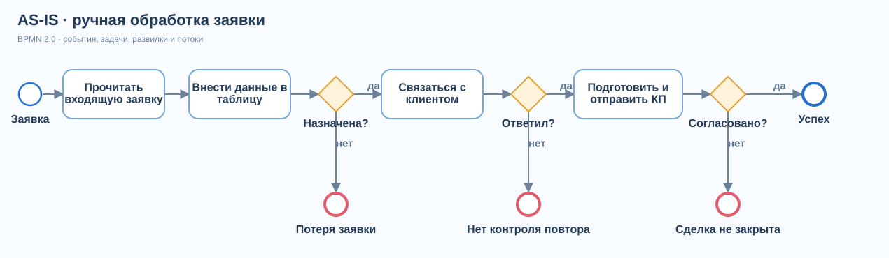

# AS-IS: текущий процесс и точки потерь

Схема описывает **предполагаемый ручной процесс** для кейса. Её нужно подтвердить интервью и выгрузкой данных перед реальным внедрением.

[Открыть редактируемую BPMN 2.0 диаграмму](diagrams/as-is.bpmn)

## Путь заявки

1. Менеджер открывает входящий канал и вручную переносит заявку в таблицу.
2. Ответственный определяется вручную; без явного владельца заявка может остаться без контакта.
3. Менеджер связывается с клиентом. Если клиент не ответил, срок повторной попытки зависит от личных заметок.
4. Для заинтересованного клиента готовится коммерческое предложение. Контроль решения также ведётся вручную.
5. Результат может не попасть в общую воронку и отчёт руководителя.

## Гипотезы проблем

| ID | Точка потери | Возможная причина | Наблюдаемый сигнал для проверки | Последствие |
|---|---|---|---|---|
| P1 | Между каналом и таблицей | Ручной перенос, несколько источников | Число заявок в источнике больше числа карточек | Заявка не попадает в работу |
| P2 | После регистрации | Нет явного владельца или срока реакции | Пустой ответственный, нет первого контакта в SLA | Запоздалый ответ |
| P3 | После неудачного контакта | Следующий шаг хранится в личных записях | Нет повторной задачи или срока | Заявка забыта |
| P4 | После отправки КП | Нет контрольной задачи и конечного статуса | Сделка долго висит на этапе «Предложение» | Неполный прогноз и потеря шанса на закрытие |

**Неизвестно:** частота P1–P4, их реальное влияние на выручку, доля дублей и медианное время ответа. Числа в [экономической модели](07-economics.md) не являются измерением этих проблем.

## Данные для базовой линии

Для каждой заявки нужны: `lead_id`, канал, время поступления, время первого контакта, ответственный, история этапов, отправка КП, дата и итог сделки. В текущем прототипе часть этих событий не ведётся как отдельный журнал; это указано в [требованиях](05-requirements.md).
