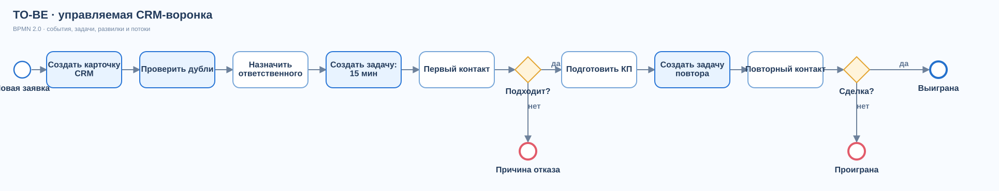

# TO-BE: целевой процесс

[Открыть редактируемую BPMN 2.0 диаграмму](diagrams/to-be.bpmn)

## Логика процесса

1. Заявка создаёт единую карточку. В целевом решении до назначения выполняется поиск дублей.
2. Руководитель или правило распределения назначает ответственного.
3. CRM создаёт задачу первого контакта со сроком **15 минут**. Просроченные задачи видны в очереди.
4. Менеджер фиксирует контакт и квалифицирует заявку. Для подходящего клиента CRM создаёт задачу подготовки КП со сроком **2 календарных дня**.
5. Переход на этап «Предложение» или «Переговоры» создаёт задачу повторного контакта через **2 календарных дня**.
6. При закрытии сделки как выигранной или проигранной все открытые задачи по ней отменяются. Причина отказа и журнал изменений входят в дальнейшее развитие.

## Правила и реализация

| Правило | Триггер | Действие | Состояние |
|---|---|---|---|
| R1 | Создан новый лид | Задача «Связаться с клиентом», срок +15 минут | Реализовано |
| R2 | Первый контакт завершён | Задача закрывается, статус нового лида меняется на «В работе» | Реализовано |
| R3 | Статус стал «Квалифицирован» | Задача «Подготовить предложение», срок +2 дня | Реализовано |
| R4 | Этап стал «Предложение» или «Переговоры» | Задача повторного контакта, срок +2 дня | Реализовано |
| R5 | Сделка закрыта | Открытые задачи отменяются | Реализовано |
| R6 | Срок открытой задачи истёк | Задача выделяется в списке просроченных | Реализовано при открытии интерфейса/API |
| R7 | Новая заявка совпала с существующей | Предложить объединить или проверить дубль | Спроектировано, не реализовано |
| R8 | Задача просрочена сверх SLA | Отправить уведомление руководителю | Спроектировано, не реализовано |

Правила R1–R5 выполняются в транзакции с изменением лида. Прототип не запускает фоновый планировщик: R6 вычисляется при запросе списка. Повторный переход на тот же статус или этап не создаёт дублирующую открытую задачу того же типа.

## Исключения

- **Нет ответственного:** задача всё равно создаётся, но попадает в очередь без назначения. На внедрении нужен отдельный SLA назначения.
- **Нет ответа клиента:** менеджер оставляет задачу открытой или меняет этап; автоматические повторные попытки и ограничения частоты контактов требуют отдельного согласования.
- **Сделка закрыта:** задачи отменяются; повторное открытие сделки не восстанавливает старые задачи автоматически.
- **Дубли:** пока не блокируются, поэтому метрики нужно очищать от дублей на стороне анализа.

Показатели контроля описаны в [KPI и плане измерения](06-kpi.md).
