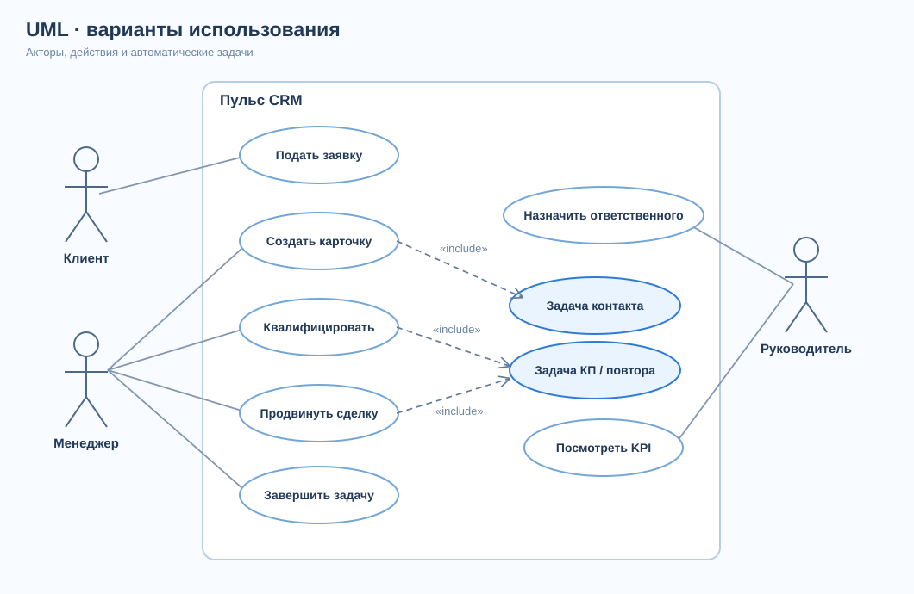
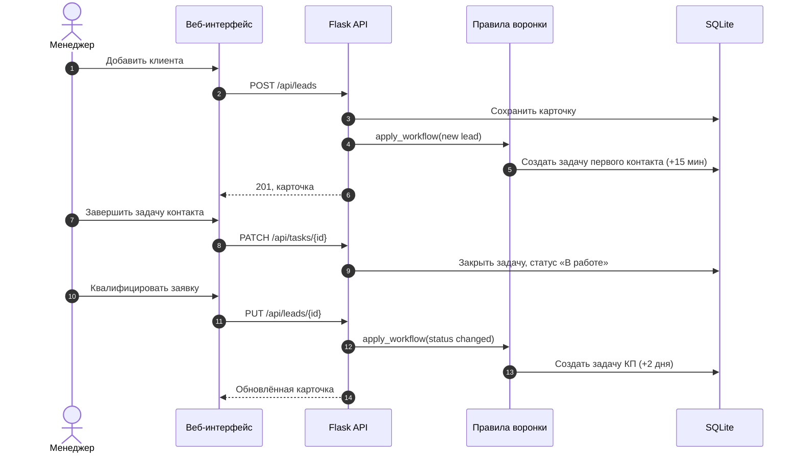

# UML: взаимодействие с CRM

## Use Case

[Исходник PlantUML](diagrams/use-case.puml)

Основные акторы — клиент, менеджер продаж и руководитель. Автоматическое создание задач включено в сценарии регистрации и продвижения заявки. SVG показывает ключевые связи; исходник PlantUML содержит расширенный перечень действий.

## Sequence Diagram: заявка → задача → квалификация

[Исходник PlantUML](diagrams/sequence.puml)

## Трассировка

| UML-сценарий | API / функция прототипа | Требование |
|---|---|---|
| Создать карточку | `POST /api/leads` | FR-01 |
| Назначить ответственного | `PUT /api/leads/{id}` | FR-03 |
| Автоматическая задача контакта | `apply_workflow()` | FR-05 |
| Завершить задачу | `PATCH /api/tasks/{id}` | FR-06 |
| Квалифицировать | `PUT /api/leads/{id}` | FR-07 |
| Посмотреть показатели | `GET /api/overview` | FR-11 |
